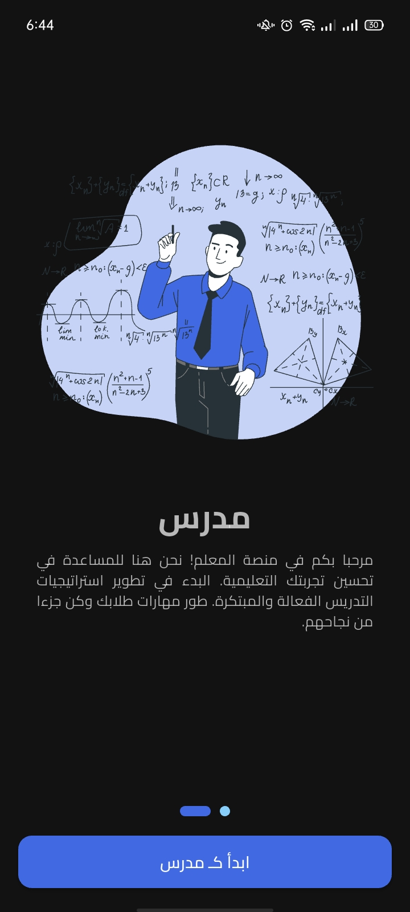
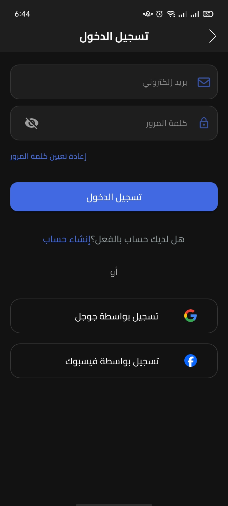
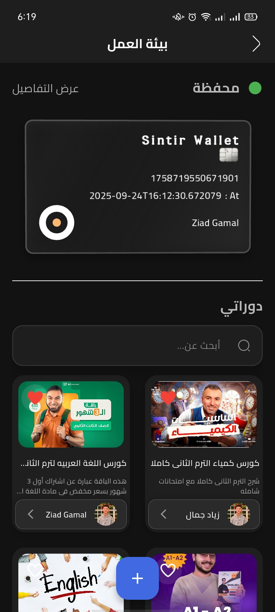
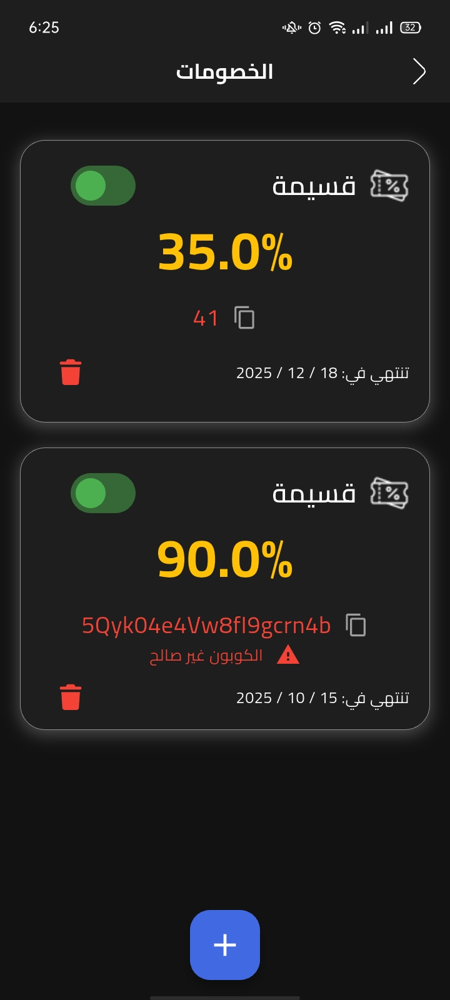
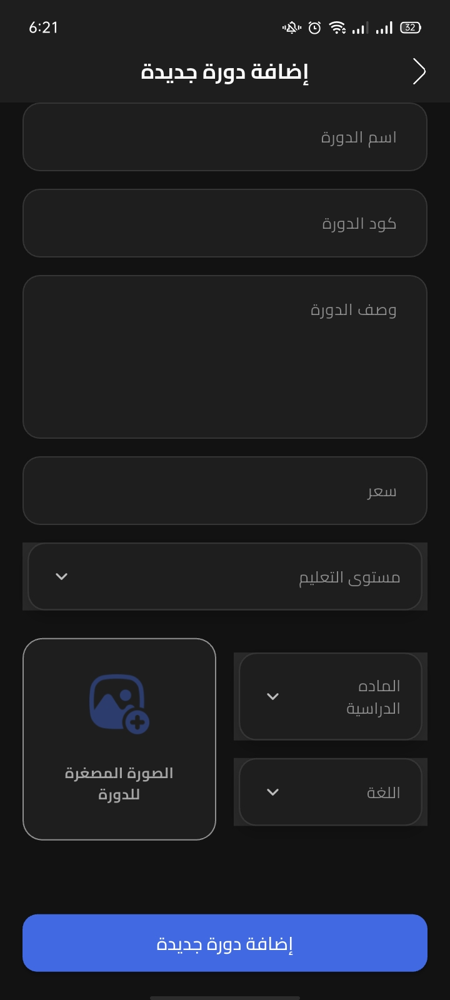
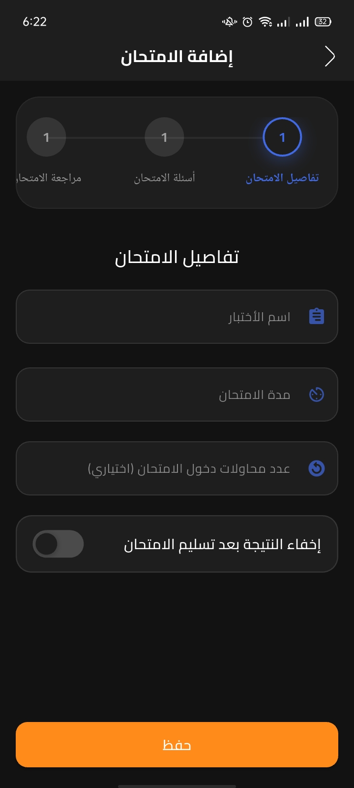
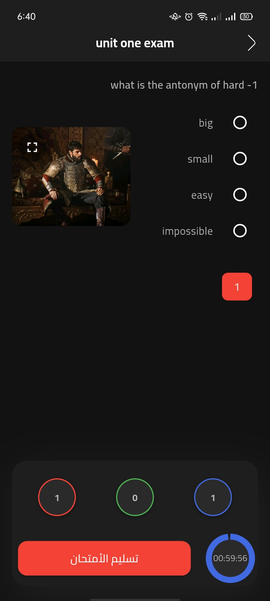
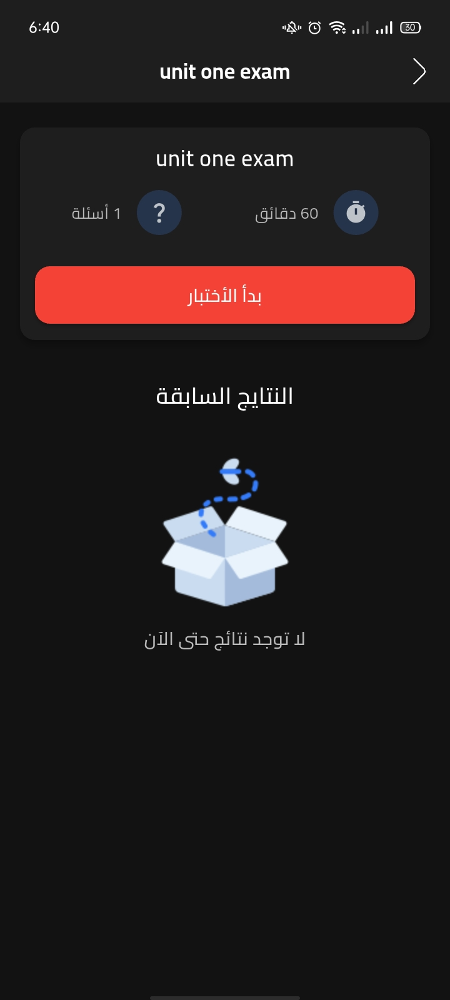
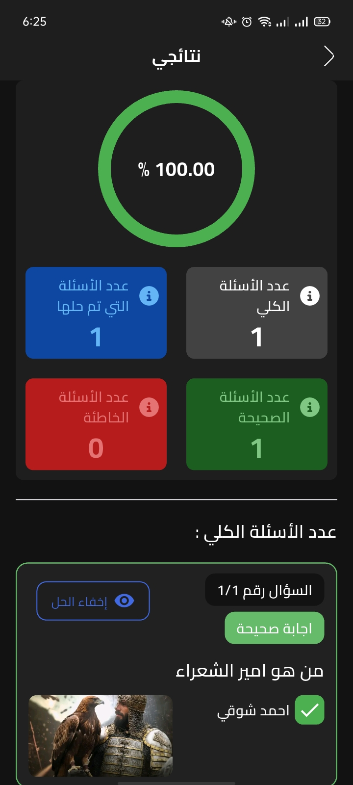

# Sintir — Digital Learning Platform

**A 59-screen multilingual Flutter application connecting instructors and students with course management, chunked video streaming, timed assessments, mistake analytics, and integrated Paymob payments.**

[**Companion Admin Panel Repo**](https://github.com/Ziad-Gamal12/Sintir_DashBoard) · [**Live Admin Dashboard**](https://sintir-2f0be.web.app/) · [**Latest Releases**](https://github.com/Ziad-Gamal12/Sintir/releases)

## 📖 Overview

**Sintir** is a full-featured digital education platform built with Flutter for students and instructors. It streamlines the entire learning lifecycle—from discovering courses and processing payments to streaming protected video lectures, taking timed exams, practicing past mistakes, and managing instructor payouts.

- **59 Screens Across Dual Role Workflows:** Covers 52 declarative `GoRouter` routes plus interactive modal sheets and sub-views tailored for both **Students** and **Teachers**.
- **Multilingual & Adaptive Design:** Ships with full **Arabic (RTL), English, and French** localization alongside persistent **Light and Dark** themes.
- **Production Back-Office Ecosystem:** Operates alongside the [**Sintir Admin Panel**](https://github.com/Ziad-Gamal12/Sintir_DashBoard) ([Live Demo](https://sintir-2f0be.web.app/)), which provides role-based back-office governance over courses, users, support tickets, and platform analytics.

## 📱 Screenshots

| Select Sign-In Role | Sign In as Student | Student Home Feed |
| :---: | :---: | :---: |
|  |  |  |

| Course & Teacher Search | Instructor Wallet | Course Coupons |
| :---: | :---: | :---: |
|  |  |  |

| Create Course | Build Exam | Active Timed Exam |
| :---: | :---: | :---: |
|  |  |  |

| Pre-Exam Instructions | Post-Exam Analytics & Results |
| :---: | :---: |
|  |  |

## ✨ Key Features

### 🎓 For Students
- **Curated Discovery & Search:** Browse popular, newest, and interest-matched courses on the home feed, or search courses and instructors with filters for price, education level, and subscription status.
- **Course Enrollment & Paymob Checkout:** Preview course syllabi, apply discount coupons, and complete purchases via **Paymob Unified Checkout** (supporting online cards, mobile wallets, kiosk, and cash collection).
- **Interactive Learning Player:** Stream protected course videos using token-authenticated playback, add timestamped video notes, and read attached PDF study materials (`pdfx`) inside the app.
- **Timed Assessments & Attempt Tracking:** Take countdown-timed exams (`stop_watch_timer`) with question navigation, attempt limits, and automated grading.
- **Mistake Bank & Custom Practice Exams:** Review historical exam results and incorrect answers with highlighted solutions, and generate custom practice exams directly from saved mistakes.
- **Feedback, Reporting & Support:** Rate courses, submit content reports, track payment history, and chat with support agents via real-time support tickets.

### 👨‍🏫 For Teachers
- **Course & Curriculum Builder:** Create courses with metadata (subject, education level, language, pricing) and organize content into structured sections containing video lectures, downloadable files, and exams.
- **Resumable Chunked Video Uploads:** Upload large lecture videos using byte-range chunking with automatic retry, pause/resume, and cancellation orchestrated via Supabase Edge Functions.
- **Multi-Step Exam Authoring:** Build rich assessments with image attachments, multiple-choice options, custom durations, and maximum attempt rules.
- **Engagement & Performance Analytics:** Track per-video attendance, inspect student video notes, and analyze exam completion rates and score distributions (`fl_chart`).
- **Coupon & Subscriber Management:** Generate promotional course coupons, inspect enrolled students, and review or resolve student content reports.
- **Instructor Wallet & Withdrawals:** Monitor wallet balances, total earnings, and transaction logs, and submit payout requests processed through **Paymob** via the `teacher-withdrawal` Edge Function.

## 🛡️ Engineering Highlights & Security

- **Device-Bound Authentication:** Prevents unauthorized account sharing by pairing user sessions with hardware identifiers (`unique_device_identifier`) verified through `GetUserDataCubit` against Firestore user records.
- **Anti-Capture Content Protection:** Protects proprietary educational videos and exams using `PrivacyWrapper` and `SensitivePageWrapper` (`secure_content`) to restrict unauthorized screenshots and screen recording.
- **Encrypted Local Storage:** Secures sensitive local cache using `hive_flutter` encrypted with keys stored in `flutter_secure_storage`, paired with `hydrated_bloc` for seamless state restoration.
- **Serverless Media & Payout Pipeline:** Keeps third-party API secrets off the client by routing video upload session creation, signed playback token generation, and teacher payouts through authenticated **Supabase Edge Functions** verified with Firebase ID tokens.

## 🛠 Tech Stack

| Category | Packages & Technologies |
| :--- | :--- |
| **Framework & Language** | Flutter (Android, iOS, Web, Desktop scaffolding), Dart `^3.5.0` |
| **State Management** | `flutter_bloc`, `bloc`, `hydrated_bloc`, `bloc_concurrency`, `provider` |
| **Dependency Injection** | `get_it` |
| **Navigation & Routing** | `go_router` (52 declarative routes with typed `state.extra` payloads) |
| **Backend & Serverless** | Firebase Auth, Cloud Firestore, Supabase Storage, Supabase Edge Functions |
| **Payments & Payouts** | Paymob Unified Checkout (`PayMobService` via `dio` + WebView), `teacher-withdrawal` Edge Function |
| **Networking** | `dio`, `http` |
| **Media & Documents** | `better_player_plus`, `video_player`, `pdfx`, `webview_flutter`, `image_picker`, `file_selector` |
| **UI, Charts & Animations** | `fl_chart`, `percent_indicator`, `flutter_animate`, `lottie`, `skeletonizer`, `awesome_dialog`, `cached_network_image` |
| **Security & Auth Providers** | `google_sign_in`, `flutter_facebook_auth`, `flutter_secure_storage`, `secure_content`, `unique_device_identifier`, `crypto` |
| **Local Persistence** | `hive_flutter` (encrypted), `shared_preferences`, `path_provider` |
| **Localization** | `flutter_localizations`, `intl`, `localingo` (Arabic, English, French) |
| **Functional & Utilities** | `dartz`, `meta`, `uuid`, `stop_watch_timer`, `restart_app` |
| **Testing & Linting** | `flutter_test`, `test_api`, `flutter_lints` |

## 🏗 Architecture

Sintir is structured around **Clean Architecture** principles with a **feature-first** modular organization. Features encapsulate their own **Presentation** (Views, Widgets, Cubits), **Domain** (Entities, Repository Interfaces), and **Data** (Models, Repository Implementations) layers, while cross-cutting repositories and service abstractions live in `lib/Core/`.

~~~mermaid
flowchart LR
    UI[Presentation Layer Views & Widgets] --> Cubit[State Management BLoC / Cubit]
    Cubit --> Repo[Domain / Core Repository Interface]
    Repo --> RepoImpl[Data Layer Repository Implementation]
    RepoImpl --> DB[Shared Services Firestore / Storage / Paymob]
    DB --> FB[(Firebase Auth & Firestore)]
    DB --> SB[(Supabase Storage & Edge Functions)]
~~~

### Example Data Flow: Course Video Playback & Upload
1. **View:** `DisplayCourseVedioVeiw` dispatches playback or upload actions to `VideoItemCubit`.
2. **Cubit:** `VideoItemCubit` coordinates state transitions and invokes `VideoItemRepo`.
3. **Repository:** `VideoItemRepoImpli` queries item metadata via `FirebaseFirestoreservice` and delegates media operations to `VideoUploadService`.
4. **Service & Edge Functions:** `VideoUploadService` attaches the user's Firebase ID token, calls Supabase Edge Functions (`create-video-upload`, `resume-video-upload`, or `get-video-playback-token`), and handles byte-range chunk uploads with automatic retries.

### Folder Structure

~~~text
lib/
├── Core/
│   ├── Entities/          # Shared domain entities across features
│   ├── Errors/            # Failure classes and exception mapping
│   ├── Helper/            # UI helpers, dialogs, and formatters
│   ├── Managers/          # Shared Cubits (video item, theme, locale, user data)
│   ├── Models/            # Shared data models and serialization
│   ├── Themes/            # Light and Dark ThemeData definitions
│   ├── repos/             # Shared repository contracts and implementations
│   ├── services/          # Firebase, Supabase, Paymob, VideoUpload, and GetIt setup
│   ├── utils/             # GoRouter (App_router.dart), Backend_EndPoints, AppTextStyles
│   └── widgets/           # Reusable UI components and Paymob WebView checkout
├── Features/
│   ├── Auth/
│   ├── ChoosingUserKind/
│   ├── ContentCreatorProfile/
│   ├── CourseManagementAndInteractionFeature/
│   ├── Favorites/
│   ├── Home/
│   ├── MyCourses/
│   ├── MyMistakes/
│   ├── MyResults/
│   ├── MyTransactions/
│   ├── Profile/
│   ├── Search/
│   ├── Splash/
│   ├── StudentOnboarding/
│   ├── Subscribtion/
│   ├── Support/
│   ├── TeaacherOnBoarding/
│   └── TeacherWorkEnvironment/
├── generated/             # Generated localization delegates
├── l10n/                  # Localization ARB resources
├── constant.dart          # App-wide constants and public config keys
├── firebase_options.dart  # Platform-specific Firebase initialization options
├── locale_keys.dart       # Localization key definitions
└── main.dart              # App entry point, storage encryption, and DI bootstrap
~~~

## ☁️ Backend & Cloud Services

### Cloud Firestore Collections
- **Top-Level Collections:** `Users`, `Students`, `Teachers`, `Courses`, `Transactions`, `Tickets`
- **User & Teacher Subcollections:** Enrolled courses, `Favorites`, `MyResults`, `MyMistakes`, and `Transactions`
- **Course Subcollections:** `Sections` → `Items` (`Results`, `JoinedBy`, `VideoNotes`), `Subscribers`, `Reports`, `Feedbacks`, and `Coupons`
- **Support Subcollections:** `Tickets/{ticketId}/Messages`

### Supabase Storage & Edge Functions
- **Storage Buckets:** `Courses`, `Users`, `DefaultBucket`, `Support` (used for course thumbnails, PDFs, profile avatars, and support attachments)
- **Edge Functions:**
  | Edge Function | Responsibility |
  | :--- | :--- |
  | `create-video-upload` | Validates teacher authorization and initializes a chunked video upload session |
  | `resume-video-upload` | Checks upload status and resumes interrupted byte-range transfers |
  | `cancel-video-upload` | Cancels an active upload session and cleans up pending video records |
  | `get-video-playback-token` | Verifies student enrollment and issues a signed video playback token |
  | `teacher-withdrawal` | Processes instructor wallet payout requests through Paymob |

## 🎨 Localization & Theming

- **Supported Languages:** Arabic (`ar` — default startup locale with RTL layout), English (`en`), and French (`fr`), managed by `LocaleCubit`.
- **Adaptive Theming:** Full Light and Dark mode palettes defined in `lib/Core/Themes/app_theme.dart` and persisted across app launches via `ThemeCubit` and `HydratedBloc`.
- **Typography:** Uses **Cairo** and **Poppins** font families (`Regular`, `Medium`, `SemiBold`, `Bold`) paired with a centralized `AppTextStyles` scale.

## 🚀 Getting Started

### Prerequisites
- [Flutter SDK](https://docs.flutter.dev/get-started/install) with Dart `^3.5.0`
- Configured **Firebase** project (Authentication & Cloud Firestore)
- Configured **Supabase** project (Storage & Edge Functions)
- **Paymob** merchant account (for course checkout and wallet integrations)

### Installation & Setup

1. **Clone the repository**
   ~~~bash
   git clone https://github.com/Ziad-Gamal12/Sintir.git
   cd Sintir
   ~~~

2. **Install dependencies**
   ~~~bash
   flutter pub get
   ~~~

3. **Configure Firebase**
   - Generate your `lib/firebase_options.dart` via the FlutterFire CLI (`flutterfire configure`) or place your platform files in:
     - Android: `android/app/google-services.json`
     - iOS: `ios/Runner/GoogleService-Info.plist`

4. **Configure Environment & Service Keys**
   - Provide your Supabase and Paymob configuration values in `.env` / `lib/constant.dart`:
     ~~~text
     supaBaseUrl
     supaAnonKey
     PayMobTestPublicKey
     PayMobSecretKey
     PaymobWalletsIntegrationID
     PaymobOnlineCardIntegrationID
     PaymobAcceptKioskIntegrationID
     PaymobCashCollectionIntegrationID
     ~~~
   > **Security Note:** Never commit production secret keys to version control. Keep `.env` excluded via `.gitignore`.

5. **Run the application**
   ~~~bash
   flutter run
   ~~~

### Build & Test Commands

~~~bash
# Run unit tests (course actions, report helpers, video models, withdrawal logic)
flutter test

# Build release artifacts
flutter build apk
flutter build appbundle
flutter build ios
~~~

## 👤 Author

**Ziad Gamal** — Flutter Developer

- **LinkedIn:** [linkedin.com/in/ziad-gamal-54b052375](https://www.linkedin.com/in/ziad-gamal-54b052375/)
- **GitHub:** [@Ziad-Gamal12](https://github.com/Ziad-Gamal12)
- **Email:** [ziadgamal.work@gmail.com](mailto:ziadgamal.work@gmail.com)
