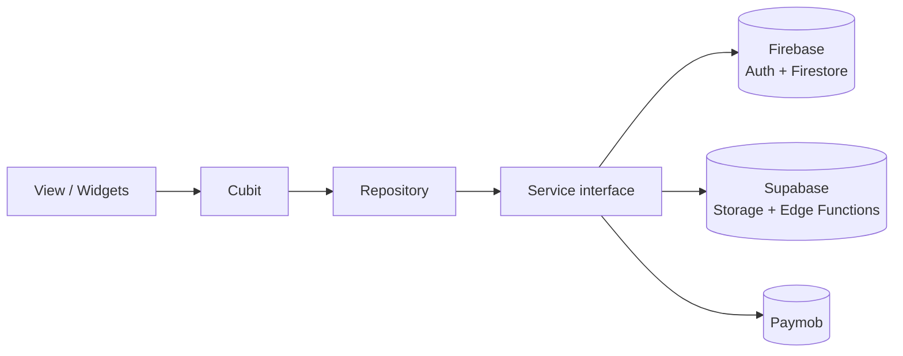

<div align="center">

<!-- Put your logo in docs/screenshots/logo.png (or point to an asset in the repo) -->


# Sintir

**A Flutter learning platform that connects teachers and students: courses, secure video lessons, timed exams, progress tracking, payments and a teacher wallet.**


[Features](#-features) · [Screenshots](#-screenshots) · [Architecture](#-architecture) · [Getting Started](#-getting-started) · [Admin Panel](https://github.com/Ziad-Gamal12/Sintir_DashBoard)

<!-- Add when available: [Download APK](link) · [Demo video](link) -->

</div>

---

## 📖 Overview

Sintir makes digital education simple for both sides:

- **Students** browse and search courses, subscribe, watch video lessons, take timed exams, review their mistakes and follow their results.
- **Teachers** build courses from sections and lessons, upload videos, create exams and coupons, track attendance and earnings, and withdraw their balance.

The app has **52 routed screens**, three languages (**Arabic, English, French**), light and dark themes, and Paymob payments. It is managed through the separate [**Sintir Admin Panel**](https://github.com/Ziad-Gamal12/Sintir_DashBoard) (Flutter Web).

> **Status:** actively developed.

---

## ✨ Features

### 🧑‍🎓 Students

- Home with popular, newest and interest-based course lists
- Search courses and teachers, with filters
- Course introduction and subscription through Paymob
- My Courses and Favorites
- Video lessons, attached files and course exams
- Timed exams with submission, detailed results and performance review
- **My Mistakes**: review wrong answers and generate a new exam from them
- Course reports and course feedback
- Transactions and subscription history
- Support tickets with a message thread
- Profile, settings, language and theme switching

### 👩‍🏫 Teachers

- Create and manage courses
- Organize content into sections with video, file and exam items
- Resumable video upload: chunked, with retry, cancel and resume
- Create and manage course coupons
- View subscribers and subscriber details
- Read student feedback and course reports
- Exam attendance and result statistics
- Video attendance and student video notes
- **Wallet**: balance, earnings and transactions
- Withdrawal requests and payout terms
- Dedicated teacher onboarding, sign-in and terms

### 🌐 General

- Sign in with Email/Password, Google or Facebook
- Arabic (default), English and French
- Light and dark themes
- Device-bound accounts and screenshot prevention

---

## 📸 Screenshots

<!-- Retake from the latest build. Put images in docs/screenshots/ and keep names short. -->

<table>
  <tr>
    <td align="center"><br/><sub>Home</sub></td>
    <td align="center"><br/><sub>Search</sub></td>
    <td align="center"><br/><sub>Course</sub></td>
  </tr>
  <tr>
    <td align="center"><br/><sub>Timed exam</sub></td>
    <td align="center"><br/><sub>Result</sub></td>
    <td align="center"><br/><sub>Teacher wallet</sub></td>
  </tr>
  <tr>
    <td align="center"><br/><sub>Dark theme</sub></td>
    <td align="center"><br/><sub>Upload video</sub></td>
    <td align="center"><br/><sub>English</sub></td>
  </tr>
</table>

---

## 🛠 Tech Stack

| Area | Tools |
| --- | --- |
| Framework | Flutter, Dart `^3.5.0` |
| State management | `flutter_bloc`, `bloc`, `hydrated_bloc`, `bloc_concurrency` |
| Dependency injection | `get_it` |
| Routing | `go_router` |
| Backend | Firebase Auth, Cloud Firestore |
| Storage & serverless | Supabase Storage, Supabase Edge Functions |
| Payments | Paymob (Unified Checkout via `dio` + WebView) |
| Auth providers | `google_sign_in`, `flutter_facebook_auth` |
| Video & files | `better_player_plus`, `video_player`, `pdfx` |
| Charts & UI | `fl_chart`, `percent_indicator`, `skeletonizer`, `flutter_animate`, `lottie` |
| Security | `flutter_secure_storage`, `secure_content`, `unique_device_identifier`, encrypted `hive_flutter` |
| Localization | `flutter_localizations`, `intl`, `localingo` |
| Functional utilities | `dartz` |
| Design | Figma, Cairo + Poppins fonts |

---

## 🏗 Architecture

Sintir uses a **feature-first** structure with **Clean Architecture** layers (data / domain / presentation) and **Cubits** for UI state. Services and repositories are registered with GetIt.



**Example: playing a course video**

1. The video player view asks the video item Cubit for the lesson.
2. The Cubit calls the video item repository.
3. The repository reads the lesson from Firestore and asks the video service for playback credentials.
4. The video service calls the `get-video-playback-token` Edge Function with the user's Firebase ID token.
5. The player streams the video using the returned token.

### Folder structure

```text
lib/
├── Core/                # Services, routing, themes, shared entities, repos, widgets, errors
├── Features/
│   ├── Auth/
│   ├── ChoosingUserKind/
│   ├── ContentCreatorProfile/
│   ├── CourseManagementAndInteractionFeature/
│   ├── Favorites/
│   ├── Home/
│   ├── MyCourses/
│   ├── MyMistakes/
│   ├── MyResults/
│   ├── MyTransactions/
│   ├── Profile/
│   ├── Search/
│   ├── Splash/
│   ├── StudentOnboarding/
│   ├── Subscribtion/
│   ├── Support/
│   ├── TeaacherOnBoarding/
│   └── TeacherWorkEnvironment/
├── generated/           # Generated localization code
├── l10n/                # Localization sources
├── constant.dart
├── firebase_options.dart
├── locale_keys.dart
└── main.dart
```

---

## 🔐 Security

- **Authentication:** Firebase Auth (email/password, Google, Facebook).
- **Device-bound accounts:** the device ID is stored with the user record and checked on launch before the user can proceed.
- **Screenshot prevention:** built with `secure_content`.
- **Encrypted local storage:** Hive boxes are encrypted, with the key kept in `flutter_secure_storage`.
- **Video access:** playback tokens are issued by a Supabase Edge Function after the user's Firebase ID token is verified.

---

## 💳 Payments & Wallet

- **Course purchase:** the app creates a Paymob payment intention and opens Unified Checkout in a WebView.
- **Teacher wallet:** balance, earnings and transactions are shown in the teacher work environment.
- **Withdrawals:** requests are sent to the `teacher-withdrawal` Supabase Edge Function.
- **Coupons:** teachers create coupons per course (stored under the course's `Coupons` subcollection).

> Use Paymob **test** credentials for development.

---

## ☁️ Backend

**Firestore:** `Users`, `Students`, `Teachers`, `Courses`, `Transactions`, and nested collections such as `Sections`, `Items`, `Subscribers`, `Reports`, `Feedbacks`, `Coupons`, `Results`, `JoinedBy`, `VideoNotes` and `Tickets/{id}/Messages`.

**Supabase Storage buckets:** `Courses`, `Users`, `Support`, `DefaultBucket`.

**Supabase Edge Functions called by the app:**

| Function | Purpose |
| --- | --- |
| `create-video-upload` | Starts a video upload session |
| `resume-video-upload` | Resumes an interrupted upload |
| `cancel-video-upload` | Cancels an upload |
| `get-video-playback-token` | Issues playback credentials |
| `teacher-withdrawal` | Submits a teacher withdrawal |

The functions' source lives in the [Admin Panel repo](https://github.com/Ziad-Gamal12/Sintir_DashBoard) (`supabase/functions`).

---

## 🌍 Localization & Theming

- **Languages:** Arabic (default), English, French, using `localingo` with JSON files in `assets/l10n/`
- **Themes:** light and dark, controlled by `ThemeCubit`
- **Fonts:** Cairo and Poppins
- **Design tokens:** primary `#4169E2`, secondary `#FF8C1A`, shared text styles through `AppTextStyles`

---

## 🚀 Getting Started

### Prerequisites

- [Flutter SDK](https://docs.flutter.dev/get-started/install) (Dart `3.5` or newer)
- A Firebase project (Auth + Firestore)
- A Supabase project (Storage + Edge Functions)
- A Paymob account (test mode is enough)

### Installation

```bash
git clone https://github.com/Ziad-Gamal12/Sintir.git
cd Sintir
flutter pub get
```

### Configuration

1. **Firebase**
   - Generate `lib/firebase_options.dart` for your project (for example with `flutterfire configure`).
   - Android: place your `google-services.json` in `android/app/`.
   - iOS: place your `GoogleService-Info.plist` in `ios/Runner/`.
2. **Supabase and Paymob:** provide these values through `lib/constant.dart` / your local `.env` (git-ignored). Names only:

   ```text
   supaBaseUrl, supaAnonKey
   PaymobWalletsIntegrationID, PaymobOnlineCardIntegrationID,
   PaymobAcceptKioskIntegrationID, PaymobCashCollectionIntegrationID,
   PayMobTestPublicKey, PayMobSecretKey
   ```

   > Never commit real keys. Use test keys locally.

3. **Edge Functions:** deploy the functions from the Admin Panel repo to your Supabase project.

### Run & build

```bash
flutter run

flutter build apk
flutter build appbundle
flutter build ios
```

---

## 🧪 Testing

```bash
flutter test
```

Current tests cover course detail actions, course report helpers, the course video item model and withdrawal logic (`test/`).

---

## 🗺 Roadmap

- [ ] Internet-connection check
- [ ] UI polish: course, subscriber, coupon and transaction cards
- [ ] Favorites tab in the bottom navigation
- [ ] Broader test coverage (Cubits and repositories)
- [ ] CI workflow (analyze + test + build)

---

## 👤 Author

**Ziad Gamal** · Flutter Developer

[GitHub](https://github.com/Ziad-Gamal12) · [LinkedIn](#) · [Email](#) <!-- add your links -->

---

## 📄 License

<!-- Add a LICENSE file (e.g. MIT) and update this line. -->
