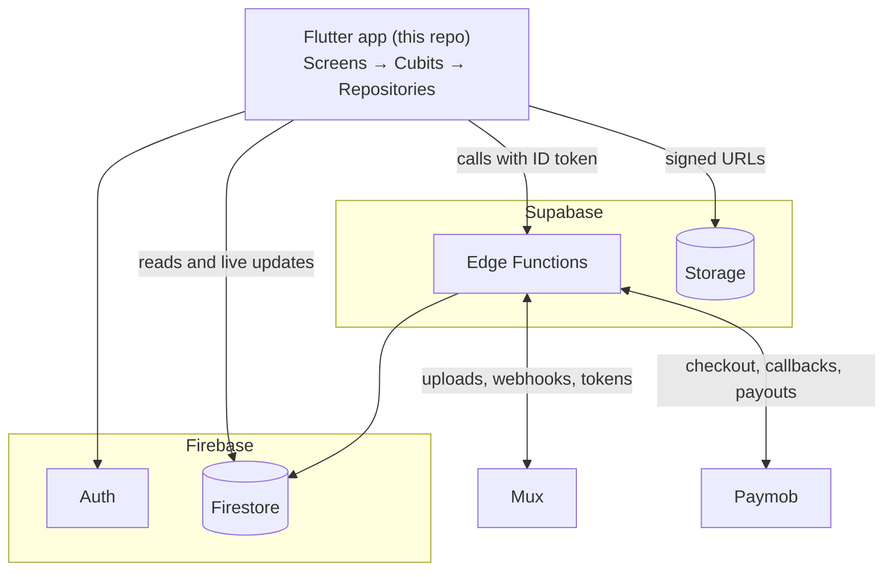

<div align="center">


# Sintir

**The tutoring center, in your pocket.**

A Flutter app where Egyptian school students find teachers, buy their courses, watch video lessons and take exams, and where teachers run the business side: content, students, coupons and payouts.

Designed and built solo · 20 feature modules · about 84k lines of Dart

[Demo video (MP4, 7 MB)](Screenshots/SINTIR_Demo_v3_GitHub.mp4) · [Admin dashboard repo](https://github.com/Ziad-Gamal12/Sintir_DashBoard) · [LinkedIn](https://www.linkedin.com/in/ziad-gamal-54b052375/) · [Email](mailto:ziadgamal.work@gmail.com)


</div>

## What's worth a look

- **[Payments the app can't tamper with](#payments-the-app-cannot-tamper-with).** The server sets the price, reserves the order idempotently, and enrolls the student only after Paymob's signed callback.
- **[Exams graded on the server](#exams-graded-on-the-server).** The answer key never reaches the student's phone, and attempt limits hold even under concurrent submissions.
- **[A video bug traced into the platform](#green-bars-on-android-video).** Green bars on some Android phones came from decoder padding. I fixed them by changing how Flutter renders the video surface.
- **[Tests where mistakes are expensive](#testing).** 32 emulator tests for the Firestore rules, plus unit and widget tests for checkout recovery, the teacher wallet and exam results.

## Screenshots

| Subscribe and pay | Recorded lessons | Timed exams |
| :---: | :---: | :---: |
|  |  |  |
| **Upload lessons** (teacher) | **Auto-graded exam reports** (teacher) | **Earnings and payouts** (teacher) |
|  |  |  |

<details>
<summary><b>11 more screens</b></summary>

| | | |
| :---: | :---: | :---: |
|  |  |  |
|  |  |  |
|  |  |  |
|  |  | |

</details>

## Why it exists

*Sintir* (سنتر) is what Egyptian students call the private tutoring center they go to after school. When teachers take those lessons online, they usually stitch together WhatsApp groups, shared Drive links and manual wallet transfers. Paid videos get passed around, payments are hard to track, and nobody can see how students are actually doing.

Sintir puts that loop in one app: students discover, pay, learn and get graded; teachers publish, see who is struggling, and get paid.

## Features

**Students**
- Home feed of most-watched, newest and interest-matched courses; search by course or teacher with price, level and subscription filters.
- Paymob checkout with coupons, and a status screen that waits for the server to confirm the payment.
- Video lessons with quality switching and timestamped notes; PDF materials open in the app.
- Timed exams with question navigation and attempt limits.
- A mistakes bank that saves every wrong answer, and lets students build a practice exam from them.
- Ratings, reviews, content reports, payment history and live support tickets.

**Teachers**
- Course builder with sections of videos, files and exams. Editing published content sends the course back to review.
- Resumable video uploads that you can pause, resume or cancel.
- Exam authoring with images, answer explanations, time limits, attempt limits and an option to hide results.
- Reports per exam and per video: attendance, pass rate, score spread and each student's notes.
- Subscriber list, coupons, review replies and report handling.
- A wallet showing earnings after commission, with withdrawals to mobile wallets.

## Engineering highlights

### Payments the app cannot tamper with

The app never sends a price.

1. `course-checkout-quote` computes the amount on the server, in integer piastres, from the course and coupon stored in Firestore.
2. `create-course-payment` takes an idempotency key and reserves the coupon and the attempt *before* it calls Paymob.
3. Enrollment is written only on the server, after Paymob's HMAC-signed callback or a server-side status inquiry confirms the payment.
4. The app polls `get-course-payment-status`. The payment redirect is never treated as proof.

### Exams graded on the server

The answer key lives in a private subdocument that only the teacher and the server can read, so the questions a student downloads carry no `isCorrect` flags. `submit-test-attempt` checks enrollment and the attempt limit, grades, and writes the teacher's copy, the student's copy and the wrong answers in one Firestore transaction. Result IDs are `{uid}-attempt-{n}`, so two simultaneous submissions can't both use the last attempt.

### Paid video delivery

- **Upload:** teachers upload straight to Mux through signed direct uploads, in 5 MiB chunks that resume after a dropped connection. A Mux webhook marks the lesson ready.
- **Playback:** `get-video-playback-token` checks *both* enrollment records (the student's and the course's) before it signs a short-lived playback token. The app keeps that token in memory only.

### Green bars on Android video

Some hardware decoders pad frames to an aligned size; an 854 px-wide video decodes into an 896 px buffer. On Android 10+, Flutter's texture path ignores the decoder's crop rectangle ([flutter#144407](https://github.com/flutter/flutter/issues/144407)), so the padding showed up as a green bar along the edge.

I replaced `better_player_plus` with `video_player` and render through a platform view (`SurfaceView`). Android composites that surface itself, with the crop applied. A native surface doesn't follow Flutter's page transitions, so full screen became its own route with no animation.

### Security in layers

- **Firestore rules:** 482 lines, covered by 32 emulator tests with names like *"sign-up cannot pick a privileged role or status"* and *"teachers cannot approve themselves or fake stats"*.
- **Server checks:** every Edge Function call carries a Firebase ID token, which the function verifies.
- **Local data:** the cached profile is stored in Hive, encrypted with a key held in `flutter_secure_storage`. The app goes black in the recent-apps switcher.
- **Not active yet:** blocking screenshots on lesson and exam screens, and biometric re-auth on the wallet, are built (`SensitivePageWrapper` over `secure_content`) but switched off in the current build. See [Project status](#project-status).

### Arabic first, any screen size

Arabic (right-to-left) is the default locale, and about 1,280 strings are also translated into English and French. Layouts adapt at 600, 840 and 1200 dp and switch to side navigation on tablets and desktops.

## Decisions and lessons

- **Two backends, on purpose.** Reads and live updates go straight to Firestore, protected by security rules. Anything that moves money, decides a grade or unlocks paid video runs in a Supabase Edge Function. The client stays thin and is never trusted with prices or answers. The cost is two platforms to deploy and secure.
- **Grading moved off the device.** Older exam documents carried the `isCorrect` flags, so the answer key shipped with every exam. Moving grading into `submit-test-attempt` closed that hole. The function still reads the legacy format, so old exams keep working.
- **Payments get interrupted.** If a student closes the app mid-payment, the server keeps the reservation. On the next try it answers `checkout_in_progress`, and the app offers to resume that checkout instead of starting a second one.
- **Owning the video player.** Moving to `video_player` meant writing my own controls, quality switching and full-screen route. In return, I control how the video surface is rendered, which is what the green-bar fix needed.

## Architecture



The Edge Functions and the admin dashboard live in [Sintir_DashBoard](https://github.com/Ziad-Gamal12/Sintir_DashBoard/tree/master/supabase/functions).

**Conventions in this codebase**
- **Folders:** feature-first; most features are split into `data`, `domain` and `presentation`.
- **State:** one Cubit per screen or flow. App-wide state (theme, locale, favourites, network) is provided at the root, and theme and locale persist across launches with `hydrated_bloc`.
- **Errors:** repositories return `Either<Failure, T>` (`dartz`), so failures reach the UI as values, not exceptions.
- **Wiring:** dependencies are registered in `get_it`, and navigation uses `go_router` (61 routes).

```text
lib/
├── Core/
│   ├── services/     Firebase, Supabase, Edge Functions, Hive, video upload, DI setup
│   ├── repos/        repositories shared across features (courses, checkout, tests, video)
│   ├── Managers/     app-wide cubits
│   ├── responsive/   breakpoints and max-width helpers
│   ├── widgets/      shared UI, the video player, privacy wrappers
│   └── utils/        router, text styles, formatters
├── Features/         20 modules: Auth, Home, Search, MyCourses, MyMistakes, MyResults,
│                     CourseManagementAndInteractionFeature, TeacherWorkEnvironment, Support, …
└── main.dart
```

## Tech stack

| Area | Choice | Why |
| :--- | :--- | :--- |
| App | Flutter 3.38, Dart 3.10 | One codebase for phones, tablets and desktop layouts |
| State and DI | `flutter_bloc` (Cubit), `hydrated_bloc`, `get_it` | States per screen are explicit and easy to test |
| Navigation | `go_router` | Declarative routes with typed arguments |
| Data and auth | Firebase Auth (email, Google, Facebook), Cloud Firestore | Live updates and per-document security rules |
| Server logic | Supabase Edge Functions (TypeScript, Deno) | Trusted code for prices, grades and video tokens |
| Video | Mux, `video_player` | HLS streaming with signed playback |
| Payments | Paymob | Egyptian cards and mobile wallets, plus payouts |
| Storage | Supabase Storage, Hive (encrypted), `flutter_secure_storage` | Course files, and the cached profile on the device |
| UI | `fl_chart`, `skeletonizer`, `flutter_animate`, `lottie` | Reports, loading states, motion |

## Testing

There are 355 tests in 55 files (237 unit, 118 widget). They cover checkout and payment recovery, the teacher wallet and withdrawal idempotency, course reviews, exam results, live-updating lists, localization, and light/dark theme parity.

**Current state:** the last local run (24 Nov 2026) passed 293 tests and failed 94, and there's no CI yet. Most of the failures come from the test harness, not the app:

- Once the translation files grew past 50 KB, Flutter started decoding them on a background isolate. That isolate never finishes inside `testWidgets`' fake async, so those widget tests render an empty screen.
- The fix (`preloadL10nAssets` and `pumpLocalized` in `test/helpers/widget_test_helpers.dart`) is applied to the live-update tests but not yet to the rest.
- Two more tests still expect widgets from before a redesign.

```bash
flutter test          # needs lib/constant.dart (see Getting started)
```

The Firestore rules have their own suite, which runs against the emulator. It needs Node.js and Java:

```bash
cd firestore-tests
npm ci
npm test
```

## Getting started

**Prerequisites:**
- Flutter 3.38.1+ (Dart 3.10+)
- An Android device or emulator
- A Firebase project and a Supabase project

Mux and Paymob keys live in the Edge Functions, not in the app.

1. Clone and install dependencies:
   ```bash
   git clone https://github.com/Ziad-Gamal12/Sintir.git
   cd Sintir
   flutter pub get
   ```
2. Create `lib/constant.dart`. It's gitignored because it holds the Supabase keys. Only those two values matter; the UI values can be anything:
   ```dart
   import 'package:flutter/material.dart';

   const double KHorizontalPadding = 16;
   const double KVerticalPadding = 16;
   const Color KMainColor = Color(0xFF2F5BEA);
   const Color KSecondaryColor = Color(0xFFFF8A00);

   const String currentVersion = '1.0.0';
   const String supaBaseUrl = 'https://<project-ref>.supabase.co';
   const String supaAnonKey = '<supabase-anon-key>';
   ```
3. Point the app at your Firebase project with `flutterfire configure`. This rewrites `lib/firebase_options.dart` and `android/app/google-services.json`.
4. Deploy this repo's `firestore.rules`, and the Edge Functions from the [dashboard repo](https://github.com/Ziad-Gamal12/Sintir_DashBoard).
5. Run the app:
   ```bash
   flutter run
   ```

## Author

**Ziad Gamal**, Flutter developer

[LinkedIn](https://www.linkedin.com/in/ziad-gamal-54b052375/) · [GitHub](https://github.com/Ziad-Gamal12) · [ziadgamal.work@gmail.com](mailto:ziadgamal.work@gmail.com)
