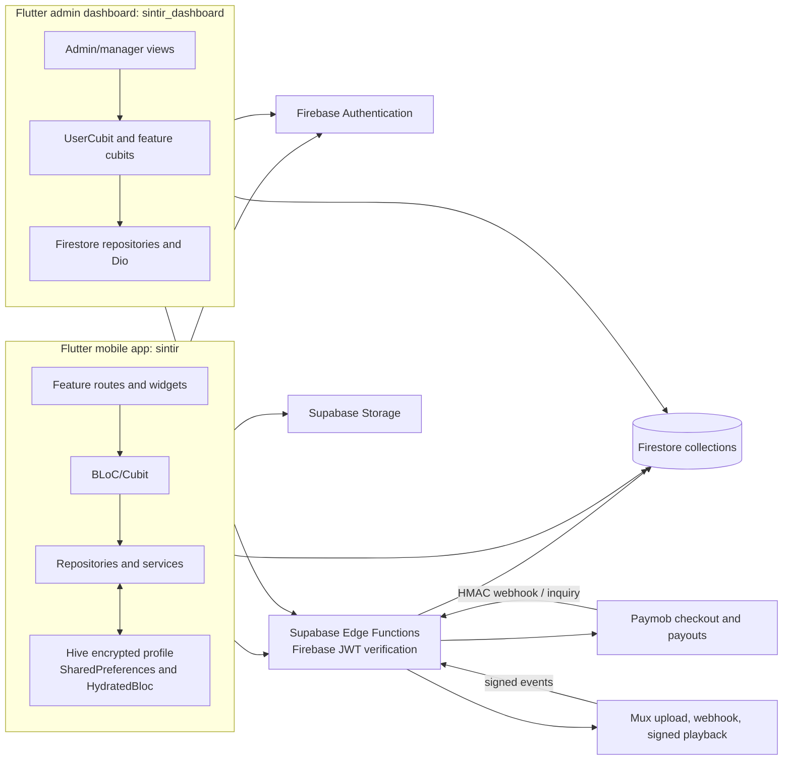
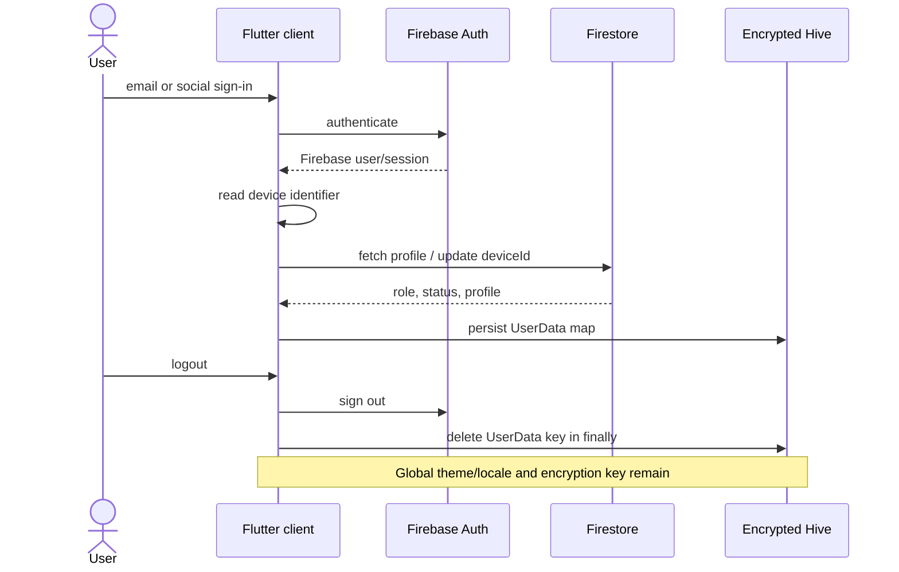
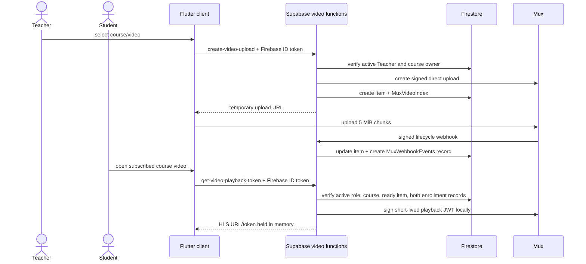
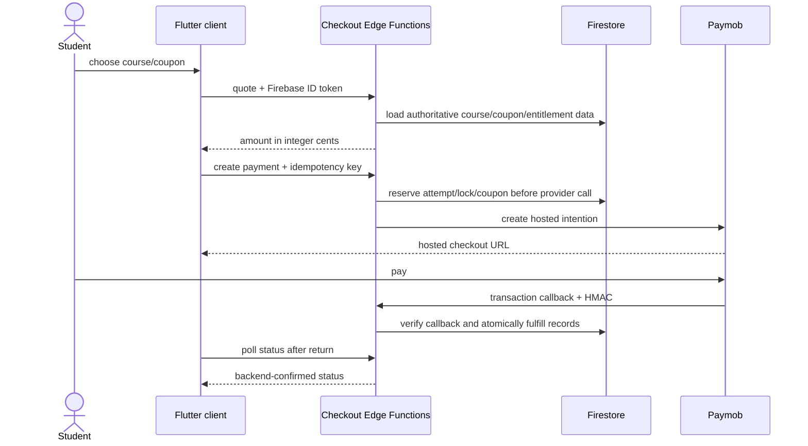
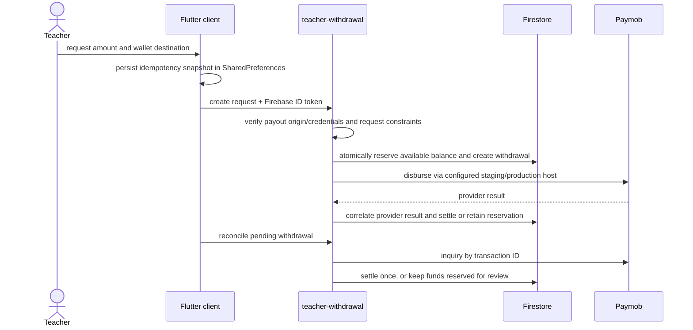

# Architecture map and sensitive data flows

This map reflects source in both local repositories. Firebase/Supabase deployed configuration and live policies were not available, so the diagrams show source-level flows rather than production proof.

## Architecture map

Mobile startup initializes Firebase, Supabase Storage, SharedPreferences, Hive, HydratedBloc, dependency injection, global cubits, and GoRouter. The app has 18 feature modules and 1,144 Dart files (prior inventory). Dashboard is a separate Flutter web/mobile-capable repo with management views and direct Firestore repositories; analytics calls Supabase functions. Payment, Mux, and withdrawal Edge Function source is present in `sintir_dashboard/supabase/functions/`.

## Authentication, session, profile, logout

`AuthRepoImpl` fetches an active profile and stores it locally. One-device handling persists a device ID field; actual concurrent-session enforcement depends on backend rules/flows and was not verified as an independent server policy. Route guards and cached role are not authorization. The previous audit fix makes empty local profile data return `UserEntity.empty()`.

## Course access, video upload, playback, subscription

Course subscription and playback are separate concepts: subscription/payment functions create the Firestore enrollment records; playback requires both `Users/{uid}/Courses/{courseId}` and `Courses/{courseId}/Subscribers/{uid}`. A source guard that prevented students reaching this check was fixed and has helper regression tests.

## Course checkout and payment confirmation

The trusted amount and fulfillment boundary is the Edge Function plus Firestore transaction; a return URL or client status is not payment authority. An ambiguous provider response retains reservation for inquiry/reconciliation.

## Wallet and teacher withdrawal

The client idempotency snapshot preserves ambiguous retries but contains personal payout information in plain SharedPreferences. This remains a P2 item. No actual payout was initiated.
